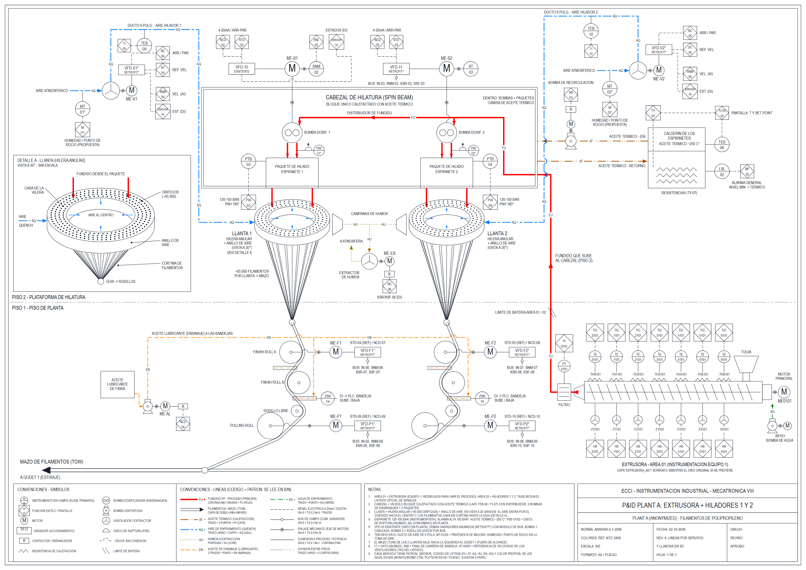

# ISA-5.1 P&ID generator for a polypropylene filament spinning line

A Python script that draws, entity by entity, the piping and instrumentation diagram (P&ID) of an extruder and two melt-spinning positions as an AutoCAD-compatible Drawing Exchange Format (DXF) file, following the ANSI/ISA-5.1 symbols and tags (American National Standards Institute / International Society of Automation).



*Revision 4 of the P&ID, A0 sheet, rendered from [`drawings/pid_spinning_line_rev4.svg`](drawings/pid_spinning_line_rev4.svg). The labels on the drawing are in Spanish. A black-and-white version for monochrome plotting is in [`drawings/pid_spinning_line_rev4_bw.png`](drawings/pid_spinning_line_rev4_bw.png).*

## Problem / context

The task was to document an existing production line with standard instrumentation symbols: a polypropylene filament extrusion and spinning line in a Colombian plastics plant (anonymized here as "PLANT A"). There were no drawings of the spinning area. The P&ID had to be built from a meeting with the plant's instrument technician, the programmable logic controller (PLC) signal list used in the course, and visual material of the machine, and then delivered as a CAD drawing that could be plotted on an A0 sheet.

Scope of the drawing:

- **Area 01, extruder** (floor 1): seven heated barrel zones, a melt filter and the melt pipe that rises to floor 2. Another team in the course instrumented the extruder; it is redrawn here only so the whole process reads on one sheet.
- **Area 02, spinning** (my part): the spin beam (one block heated with thermal oil, with the melt distributor, two gear metering pumps and two spin packs), two annular spinnerets with their quench air rings, the quench fans and ducts, the fume extractor, the thermal oil heater, and on floor 1 the spin-finish oil system and the finish and pulling rolls that send the tow to the drawing stage (out of scope).

Course: Industrial Instrumentation, Mechatronics Engineering (8th semester), Universidad ECCI, Bogotá, 2026.

## How it works

```
src/gen_pid_v4.py  ──>  drawings/pid_spinning_line_rev4.dxf  (DXF R12 / AC1009, 2400 x 1697 units, A0 proportion)
                                  │
src/dxf_preview_v4.py  ──>  .svg preview (Scalable Vector Graphics; layer colours and line patterns)  ──>  .png with headless Chrome
```

**Generator → DXF.** [`src/gen_pid_v4.py`](src/gen_pid_v4.py) uses only the Python standard library. It keeps a list of entities (`LINE`, `CIRCLE`, `TEXT`, `POLYLINE` with widths and bulges, `SOLID` arrowheads) in working coordinates with Y pointing down, and writes them as group-code pairs into a DXF R12 file with its own header, layer table and line-type table. R12 was chosen because every CAD program opens it, and because a plain-text format can be generated and checked without any CAD library. The output opens directly in AutoCAD; the extruder sits on its own layer (`EXTRUSORA_A01`) so it can be swapped for the other team's original drawing.

**Symbol library.** Each symbol is a small function that returns its size so the lines can stop at its edge:

| Function | Draws |
|---|---|
| `bubble()` | Discrete instrument circle; grows to fit the tag text |
| `plc()` | Controller or screen function (diamond inscribed in a square) |
| `motor()`, `vfd()`, `contactor()` | Motor, variable frequency drive, starter |
| `gearpump()`, `cpump()`, `fan()`, `zigzag()`, `rupture_disc()` | Metering pump, centrifugal pump, fan, heater, rupture disc |
| `llanta3d()`, `aire_interno()` | Annular spinneret and quench ring in a 30° view, with holes and the filament curtain converging to the guide |
| `svc()` | Process service line with its two-letter code inserted in the line (FU, AT, AQ, HU, EN, AG) |
| `mec()`, `com()`, `hop()`, `vhop()` | Mechanical link, fieldbus link, crossings without connection |
| `fillet_path()`, `cinta()` | Filament path wrapped around the rolls, drawn as a double line |

**Line coding.** Each service has its own layer, line pattern, width and colour, plus the letter code, so the drawing reads the same in colour and in black and white. Signals use the ISA line types: dashed for electrical signals, diamonds for fieldbus links to drives, a small circle for mechanical shaft links.

**Tag numbering and loops.** Instruments that belong to one loop share the loop number (`PTB-03` in the field, `PIA-03` in the controller). Area 01 keeps the extruder team's format (`TE-0101`, `-TH0101`); area 02 uses the tags of the course signal list, so the drawing matches the controller input/output list. Those tags are not pure ISA-5.1; the differences are explained in [`docs/isa51-tag-notation.md`](docs/isa51-tag-notation.md). Values that were not confirmed in the plant are marked with `*`.

## Results

**Final diagram (revision 4).** One A0 sheet, 1,682 top-level DXF entities (5,868 records counting polyline vertices), 417 text strings, 19 layers, 8 line types.

| | Area 02 (spinning) | Area 01 (extruder, redrawn) |
|---|---|---|
| Loops | 16: 9 speed or temperature control, 4 indication or alarm, 2 on/off with status, 1 position status | 7 zone temperature control, 7 manual fan commands, 1 pressure indication |
| Additional items | 1 proposed measurement (quench air humidity, `MT-01/02`), 1 assumed safety device (rupture discs `PSE-01/02`) | – |
| Instrument circles | 14 | 8 |
| Controller / screen functions | 26 | 15 |

The full index of tags and loops is in [`docs/instrument-index.md`](docs/instrument-index.md). The symbol counts come from intercepting the generator's `bubble()` and `plc()` calls; the loop grouping comes from my instrumentation workbook for the course (not published: it contains the course signal list).

**Revisions 1 to 4**, as recorded in the drawing files and generator headers:

| Rev. | Sheet | Size | What changed |
|---|---|---|---|
| 1 (draft) | 1600 × 1000 | 249 entities, 94 texts | First ISA P&ID of the two spinning positions only, replacing an earlier pictorial sketch. Provisional area-02 tags (`SIC/ST-0201…`, `PT/PI-0203…`, `TIC-0213`); open questions marked "(?)". |
| 2 | 1600 × 1000 | 304 entities, 120 texts | Formal sheet: frame, title block, legend and numbered notes. Motor tags (`ME-02xx`), tachogenerators on the pumps. The open questions became notes: number of heating zones in the beam, function of two unidentified pipes per position, rupture disc not confirmed. |
| 3 / 3.1 | 2400 × 1500 | 909 / 925 entities, 318 texts | After the meeting with the plant's instrument technician and with the signal list: re-tagged to the signal list; the beam redrawn as a single block heated with thermal oil (closing the two open questions about zones and pipes) with its loop `TEB-08 / TI-TN-08 / TY-07`; fume extractor, fan drives and bus signals added; the extruder (area 01) redrawn and joined to the spinning area; humidity measurement proposed. Rev. 3.1: bubbles sized to their text, standard centrifugal pump symbol, layout fixes. |
| 4 | 2400 × 1697 (A0) | 1,682 entities, 417 texts | Readability revision after the design review: one line pattern, width, colour and letter code per service; ISA signal line types (electrical, fieldbus, mechanical link); quench rings drawn in a 30° view with the filament curtain and an enlarged Detail A; larger text for A0 plotting; black-and-white plot readability. |

**Reproducibility check.** Running the original, non-anonymized generator reproduces the submitted revision-4 DXF byte for byte. The copy in this repository differs only in the anonymized title block and drive labels (see below).

## How to reproduce

Requirements: Python 3 (tested with 3.14.3). The generator and the SVG preview use only the standard library. Google Chrome or Chromium is optional, only to turn the SVG into a PNG.

```bash
cd drawings
python ../src/gen_pid_v4.py pid_spinning_line_rev4.dxf
#   OK: pid_spinning_line_rev4.dxf (5868 entidades) | notas hasta y=1674 (limite 1672)

python ../src/dxf_preview_v4.py pid_spinning_line_rev4.dxf pid_spinning_line_rev4.svg
python ../src/dxf_preview_v4.py pid_spinning_line_rev4.dxf bw.svg --bn      # all black, like a monochrome plot

# optional PNG
chrome --headless --hide-scrollbars --window-size=3400,2404 --screenshot=pid_spinning_line_rev4.png pid_spinning_line_rev4.svg
```

The generated DXF is identical to the one in [`drawings/`](drawings/). To plot it, open it in AutoCAD (zoom extents) and plot to A0 with "fit to paper"; use `monochrome.ctb` for black and white.

## What I learned and what is missing

What I learned:

- A P&ID is built from the process, not from the instruments: the drawing only made sense once the spin beam was understood as one block heated with thermal oil, which came from the meeting with the instrument technician and the signal list, not from the pictures.
- How to separate what is confirmed from what is assumed, and say so on the sheet (`*`, notes, proposals) instead of hiding the gaps.
- ISA-5.1 conventions in practice: loop numbering, the difference between a field sensor and a controller function, and line types that carry meaning.
- Drawing by code makes revisions cheap: changing a symbol function updates every instance, and the same script regenerates the sheet after each review.

What is missing or would be done differently:

- **Not verified in the plant:** the rupture discs, the 180 bar high alarm, the thermal oil temperature (about 250 °C) and the model of most drives are assumptions marked with `*`.
- **ISA purity:** the area-02 tags follow the course signal list (`PTB`, `TEB`, `STD`, `SNM`, `XSR/XSF`, `NCD`), not strict ISA-5.1 letters. The instrument circles carry a horizontal bar between letters and number; in ISA-5.1 a bar means "located in the main control room", so strictly the field instruments should be plain circles.
- **Quench air direction:** the drawing shows air entering from the side and blowing towards the centre of the ring; one view of the machine suggests the opposite (centre outwards). Not resolved.
- **Layout is hard-coded:** coordinates are written by hand, so moving one block means editing numbers. The last line of the notes block sits 2 drawing units past the inner frame (the generator prints the warning).
- **Out of scope:** the drawing stage downstream of the pulling rolls, and the control logic (no interlock or sequence diagrams).
- The extruder (area 01) is a redrawing of another team's work, not a new survey.

## Credits

- Javier Solís (javier.solis@ecci.edu.co · [github.com/javiersoliso](https://github.com/javiersoliso) · [linkedin.com/in/javiersoliso](https://linkedin.com/in/javiersoliso)).
- Course: Industrial Instrumentation, Universidad ECCI, 2026.
- The extruder instrumentation (area 01) was done by another team in the same course; it is redrawn here only to connect the process.
- Process information came from a meeting with the plant's instrument technician, the course signal list and material shared in the course. None of those source documents, photos or videos are included.
- Symbols and identification follow ANSI/ISA-5.1-2009 *Instrumentation Symbols and Identification* (ISA). The standard is not reproduced here; [`docs/isa51-tag-notation.md`](docs/isa51-tag-notation.md) is my own summary.

### On AI assistance

Parts of the code and documentation were written with the help of AI assistants (Claude): the generator, the DXF-to-SVG preview and this repository's documentation. I gathered the process information (I took the question list to the plant's instrument technician and brought back the answers, and sketched the layout of the roll train), decided which values to assume and how to mark them, presented each revision for review and set what had to change in the next one, including the per-service line coding and black-and-white readability of revision 4. I reviewed everything published here.

### Anonymization

The line belongs to a real company. This repository uses a neutral name ("PLANT A"); the company, line, manufacturer and drive brands were removed from the title block and notes of the generator, and the DXF was regenerated. Photos, videos, company data sheets and the course signal list are not published.

## License

- **Code** ([`src/`](src/)): MIT License, see [`LICENSE`](LICENSE).
- **Drawings and documentation** ([`drawings/`](drawings/), [`docs/`](docs/) and this README): Creative Commons Attribution 4.0 International (CC BY 4.0), see [`LICENSE-docs`](LICENSE-docs).
